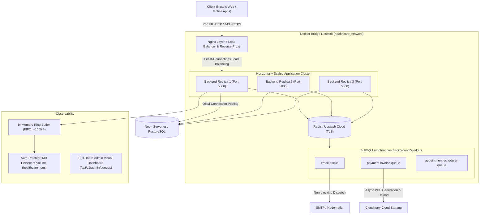

# 🏥 Healthcare Telemedicine Application — Production Backend Architecture

Welcome to the **Healthcare Application Backend**! A high-performance, enterprise-grade, horizontally scalable telemedicine backend engineered with **Node.js, Express, TypeScript, Prisma ORM, Redis, BullMQ, Docker Compose, and Nginx**.

---

## 🏗️ System Architecture & Infrastructure

Our platform is engineered as a **Stateless, Scalable, and Resilient Micro-monolith** designed to handle heavy telemedicine traffic, real-time appointment bookings, and asynchronous financial workflows with zero downtime.



---

## ⚡ Core Engineering & Production Features

### 1. Horizontally Scalable Cluster (Docker Compose + Nginx)
* **Dynamic Scaling:** Application nodes can be instantly scaled with one command (`docker compose up --scale api=3 -d`).
* **Smart Traffic Balancing:** Nginx uses the **`least_conn`** (least connections) algorithm to dynamically route incoming requests to the least busy container.
* **Health Probing & Zero-Downtime:** Automatic failover (`max_fails=3 fail_timeout=10s`). If an instance dies, Nginx seamlessly redistributes traffic without dropping user requests.
* **DDoS & Rate Limiting:** Built-in IP rate limiter (`limit_req_zone`, 30 req/s, burst 50) with dedicated bypass for Stripe webhooks.
* **WebSocket & WebRTC Signaling Ready:** Preconfigured with `Upgrade: websocket` headers for live audio/video consultations and group messaging.

### 2. Asynchronous Event-Driven Queues (BullMQ + Upstash Redis)
* **Instant API Responses (P99 Latency < 25ms):** Long-running CPU-heavy tasks are completely decoupled from Express's main event loop.
* **`email-queue`:** Handles welcome emails, password resets, and appointment notices with automatic 3-tier exponential backoff retries.
* **`payment-invoice-queue`:** When Stripe webhooks fire, the database updates in < 15ms. In the background, `PDFKit` generates the invoice, uploads it to Cloudinary, and emails the patient.
* **`appointment-scheduler-queue`:** Implements distributed repeatable cron jobs (`upsertJobScheduler`) that safely cancel expired unpaid appointments across multiple cluster replicas without race conditions.
* **Bull-Board Visual UI:** Live visual monitoring of active, waiting, completed, and failed jobs at `/api/v1/admin/queues`.

### 3. Zero-Cost Request Logger & Audit System
* **Zero Database Overhead ($0 DB Cost):** Audit logs are held in a circular in-memory FIFO buffer (capped at 300 entries, static ~100KB footprint) rather than flooding the relational database.
* **Bounded Disk Persistence:** Synchronously rotated to a Docker persistent volume (`healthcare_logs`) capped strictly at 2MB to prevent host disk exhaustion.
* **Recursive Filter:** Excludes internal monitoring (`/request-logs`, `/health`, `/favicon.ico`) to eliminate infinite logging loops.
* **Client Device & Browser Detection:** Built-in parser extracts OS (Windows, iPhone, Android, Mac) and clients (Chrome, Postman, Safari).

---

## 📡 API Endpoints Overview

### 🔐 Authentication & Accounts
* `POST /api/auth/register` — Register patient or doctor
* `POST /api/auth/login` — JWT & Better-Auth session login
* `POST /api/auth/refresh-token` — Refresh expired access token

### 👨‍⚕️ Doctors & Appointments
* `GET /api/v1/doctors` — List and filter verified doctors
* `GET /api/v1/doctors/:id` — Doctor profile, specializations, and available schedules
* `POST /api/v1/appointments` — Book an appointment slot
* `GET /api/v1/appointments/my-appointments` — Patient / Doctor appointment history

### 💳 Payments & Invoices (Stripe Webhook)
* `POST /api/v1/payments/create-checkout-session` — Generate Stripe payment session
* `POST /webhook` — Public Stripe Webhook handler (offloaded to BullMQ)

### 🛡️ Admin & Observability Endpoints
* `GET /api/v1/admin/request-logs` — Live request logs with latency, device, IP, and status analytics *(Super Admin & Admin)*
* `DELETE /api/v1/admin/request-logs/:id` — Delete a single request log entry *(Super Admin)*
* `DELETE /api/v1/admin/request-logs` — Flush/Clear all recorded request logs *(Super Admin)*
* `GET /api/v1/admin/queues` — Bull-Board Visual UI Dashboard *(Super Admin)*

---

## 🚀 Production DevOps & Cluster Runbook

### 1. Initial Setup
```bash
# 1. Clone repository
git clone https://github.com/alifhossinsajjad/Health-Care-Backend.git
cd Health-Care-Backend

# 2. Duplicate example environment file and configure variables
cp .env.example .env
```

### 2. DevOps Commands Cheat Sheet

| Task | Command | Description |
| :--- | :--- | :--- |
| **Start Standard Instance** | `docker compose up --build -d` | Builds latest code and runs 1 API, 1 Redis, and 1 Nginx. |
| **Launch Scaled Cluster** | `docker compose up --build --scale api=3 -d` | Launches 3 load-balanced API replicas behind Nginx. |
| **Scale Dynamically On-The-Fly** | `docker compose up --scale api=5 -d --no-recreate` | Instantly scales from 3 to 5 servers during traffic spikes without restarting existing containers. |
| **Scale Down** | `docker compose up --scale api=2 -d --no-recreate` | Safely scales down cluster to save server resources. |
| **View Live Aggregated Logs** | `docker compose logs -f` | Real-time streaming logs from all cluster replicas. |
| **Inspect Nginx Health** | `curl http://localhost/nginx-health` | Probes Nginx gateway health status. |
| **Stop All Containers** | `docker compose down` | Stops containers safely. Volumes (`healthcare_logs`) remain 100% intact. |

---

## 🧠 Why Horizontal Scaling? (The Architectural "Why")

### 1. Conquering the Node.js Single-Thread Constraint
Node.js runs its JavaScript execution on a single event-loop thread. Even on an 8-core CPU server, a single Node.js instance can only utilize **one CPU core (~12.5% CPU utilization)**. 
By horizontally scaling into 3 or more replicas (`api=3`), our cluster utilizes multiple CPU cores in parallel, tripling the concurrent request handling capacity.

### 2. Zero-Downtime High Availability (HA)
In a single-instance architecture, if an unhandled fatal error or memory spike causes the process to restart, all in-flight user requests drop.
In our 3-replica cluster behind Nginx (`least_conn` + `max_fails=3`):
* If `api-2` crashes or restarts, Nginx automatically detects the failure in milliseconds and routes 100% of incoming traffic to `api-1` and `api-3`.
* The end-user **never experiences an outage or 502 Bad Gateway**.

### 3. How Nginx Manages Dynamic Scaling Without Port Collisions
* In traditional setups, mapping `5000:5000` prevents running more than 1 container due to host port binding conflicts.
* We solved this by using **`expose: 5000`** inside our internal Docker bridge network (`healthcare_network`).
* Only Nginx binds to the public host **Port 80**.
* When Docker scales `api=3`, Docker's internal DNS automatically load balances the service name `http://api:5000` to all running container IPs, allowing unlimited seamless scaling!

---

## 🌟 Upcoming Roadmap
- [ ] **Socket.io + Redis Adapter:** Distributed real-time chat between patients and doctors.
- [ ] **WebRTC Video Consultations:** Peer-to-peer live telemedicine video calling.
- [ ] **AI / RAG Integration:** Automatic prescription drafting and lab test report summarizer.
- [ ] **Automated GitHub Actions CI/CD:** Auto-deployment to production VPS.
